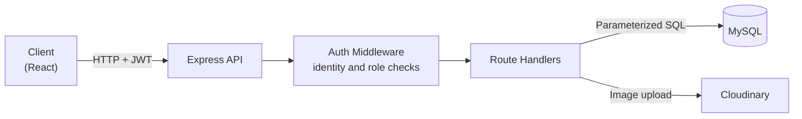
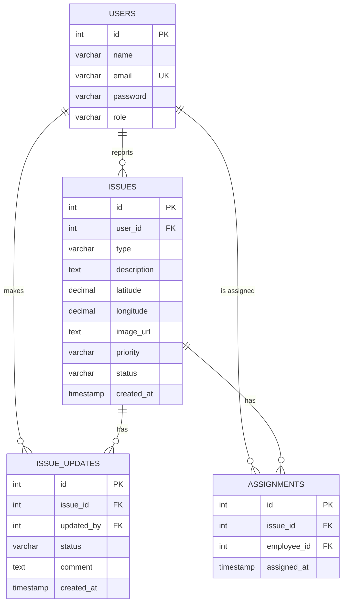

[README.md](https://github.com/user-attachments/files/32875236/README.md)
# CivicFix

**A full-stack civic engagement platform that streamlines how communities report, track and resolve public infrastructure issues.**

CivicFix enables citizens to report infrastructure concerns such as road damage, faulty street lighting, waste management problems and water supply leakages, supported by photographic evidence and precise geolocation. Municipal authorities manage these reports through a role-based workflow of verification, assignment and resolution, while a complete audit trail gives citizens full visibility into the progress of every report, from submission to resolution.

---

## 🚧 The Problem

Reporting a civic problem is often slow and opaque. Complaints get lost between departments, and citizens have no way to know whether anyone is actually working on them. Municipal staff, on the other hand, receive vague reports without a clear location or evidence.

## 💡 The Solution

CivicFix is built around three ideas:

1. **Structured reporting.** Every issue has a type, a description, precise coordinates and a photo, so staff know exactly what the problem is and where it is.
2. **Role-based workflow.** Citizens report, employees update progress, and administrators assign work. Each role can only perform the actions it is responsible for.
3. **Full transparency.** Every status change is stored in an audit trail recording who made it, when, and why, and citizens can view that timeline at any time.

> **Project status:** The backend (REST API, authentication, database and image storage) is complete and tested. The React frontend is currently in development.

---

## ✨ Features

**For citizens**
- Register and log in securely
- Report an issue with a category, description, GPS location and photo
- Track the current status and complete history of any issue

**For municipal employees**
- Update the status of issues with comments explaining the progress
- Upload photos of completed work

**For administrators**
- Assign issues to employees
- Manage the list of registered users

---

## 🛠️ Tech Stack

| Layer | Technology |
|---|---|
| Backend | Node.js, Express.js |
| Database | MySQL |
| Authentication | JSON Web Tokens, bcrypt |
| Image storage | Cloudinary, Multer |
| Frontend | React *(in progress)* |
| Maps | Mapbox or Google Maps *(planned)* |

---

## 🏗️ Architecture

Every protected request first passes through authentication and authorization checks. These checks run before any side effect, so a rejected request never uploads a file or touches the database.

---

## 🔄 Issue Lifecycle

Each transition is logged along with the staff member who made it and an optional comment, giving every issue a complete, verifiable history.

---

## 🗄️ Database Design

**Key design decisions**

- **Current state and history are stored separately.** The issue's current status is kept on the issue itself for fast reads, while the full history lives in its own table. Both are updated inside a single database transaction, so they can never disagree.
- **Flexible status values.** Statuses, priorities and roles are stored as text with validation in the application rather than as database enums, so new values can be added without altering live tables.
- **Precise coordinates.** Locations are stored as fixed-point decimals, avoiding floating-point rounding errors.

---

## 🔐 Security

Security was treated as a core requirement rather than an afterthought.

- **Password protection.** Passwords are hashed with bcrypt and are never stored or returned in plain text.
- **Token-based authentication.** Users receive a signed JWT on login that carries their identity and role and expires after 24 hours.
- **Role-based access control.** Every sensitive action is restricted to the roles that need it.
- **Ownership checks.** Users can only modify resources they own, even when they are logged in.
- **No trust in client input for identity.** User IDs are always read from the verified token, never from the request body, which prevents impersonation.
- **Privilege escalation prevention.** New accounts are always created as citizens; elevated roles can only be granted by an administrator.
- **SQL injection prevention.** All database queries are parameterized.
- **No user enumeration.** Login gives the same response for an unknown email and a wrong password.
- **Correct HTTP semantics.** The API distinguishes between unauthenticated requests (401) and authenticated but unauthorized requests (403).

---

## 🗺️ Roadmap

- [x] REST API for issues, status updates, history and assignments
- [x] JWT authentication and role-based access control
- [x] Ownership checks and privilege escalation protection
- [x] Transactional audit trail
- [x] Cloud image uploads
- [ ] React frontend with citizen reporting and issue tracking
- [ ] Municipal dashboard with map view
- [ ] Map integration
- [ ] Admin tools for managing user roles
- [ ] Automated tests and input validation layer
- [ ] Deployment

---

## 👤 Author

**Aditya Narayan**
B.Tech Computer Science and Engineering

GitHub: [@adityanarayan404](https://github.com/adityanarayan404)
