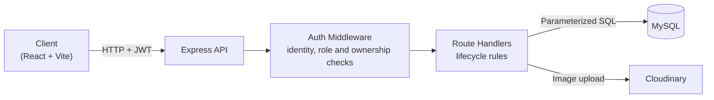
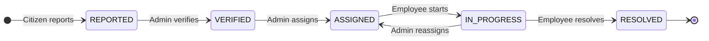
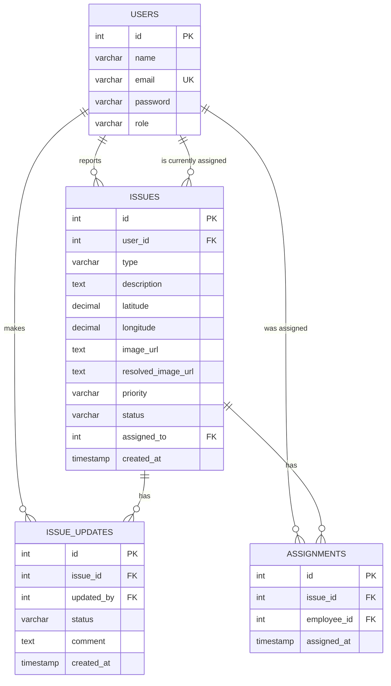

# CivicFix

**A full-stack civic engagement platform that streamlines how communities report, track and resolve public infrastructure issues.**

CivicFix enables citizens to report infrastructure concerns such as road damage, faulty street lighting, waste management problems and water supply leakages, supported by photographic evidence and precise geolocation. Municipal authorities manage these reports through a role-based workflow of verification, assignment and resolution, while a complete audit trail gives citizens full visibility into the progress of every report, from submission to resolution.

---

## 🚧 The Problem

Reporting a civic problem is often slow and opaque. Complaints get lost between departments, and citizens have no way to know whether anyone is actually working on them. Municipal staff, on the other hand, receive vague reports without a clear location or evidence.

## 💡 The Solution

CivicFix is built around three ideas:

1. **Structured reporting.** Every issue has a type, a description, precise coordinates and a photo, so staff know exactly what the problem is and where it is.
2. **Role-based workflow.** Citizens report, administrators verify and assign, and employees resolve. Each role can only perform the actions it is responsible for, and every issue moves through a fixed lifecycle.
3. **Full transparency.** Every status change and assignment is stored in an audit trail recording who made it, when, and why, and citizens can view that timeline at any time.

> **Project status:** The backend (REST API, authentication, database and image storage) is complete and tested. The React frontend is in active development: the application shell, navigation and styling system are in place, and the user-facing screens are being built next.

---

## ✨ Features

**For citizens**
- Register and log in securely
- Report an issue with a category, description, GPS location and photo
- View a personal list of every issue they have reported
- Track the current status and complete history of any issue

**For municipal employees**
- View the list of issues currently assigned to them
- Move their assigned issues forward from assigned to in progress to resolved, with comments explaining the progress
- Upload "after" photos of completed work, kept alongside the citizen's original photo

**For administrators**
- Verify incoming reports before any work is assigned
- Assign verified issues to employees, and reassign them when needed
- View the list of registered users

---

## 🛠️ Tech Stack

| Layer | Technology |
|---|---|
| Backend | Node.js, Express.js |
| Database | MySQL |
| Authentication | JSON Web Tokens, bcrypt |
| Image storage | Cloudinary, Multer |
| Frontend | React, Vite, React Router *(in progress)* |
| Styling | Tailwind CSS |
| Maps | Mapbox or Google Maps *(planned)* |

---

## 🏗️ Architecture

Every protected request first passes through authentication, authorization and ownership checks, followed by validation of the requested action. All of these checks run before any side effect, so a rejected request never uploads a file or touches the database.

---

## 🔄 Issue Lifecycle

The lifecycle is enforced by the server, not just displayed by the interface:

- **No skipped or repeated steps.** Each status has exactly one allowed next step, so an issue cannot jump straight from reported to resolved or move backwards.
- **Verification before assignment.** Only administrators can verify a report, and unverified reports cannot be assigned.
- **Only the assigned employee moves an issue forward.** Being an employee is not enough; the issue must be assigned to them.
- **No duplicate or invalid assignments.** Issues can only be assigned to employees, never twice to the same person, and never after they are resolved.

Each transition is logged along with the person who made it and an optional comment, giving every issue a complete, verifiable history.

---

## 🗄️ Database Design

**Key design decisions**

- **Current state and history are stored separately.** An issue's current status and current assignee are kept on the issue itself for fast reads, while their full histories live in dedicated tables. Each pair is updated inside a single database transaction, so they can never disagree.
- **Evidence is never overwritten.** The citizen's original photo and the staff member's "after" photo are stored separately, so a completion photo can never replace the original evidence.
- **Flexible status values.** Statuses, priorities and roles are stored as text with validation in the application rather than as database enums, so new values can be added without altering live tables.
- **Precise coordinates.** Locations are stored as fixed-point decimals, avoiding floating-point rounding errors.

---

## 🔐 Security

Security was treated as a core requirement rather than an afterthought.

- **Password protection.** Passwords are hashed with bcrypt and are never stored or returned in plain text.
- **Token-based authentication.** Users receive a signed JWT on login that carries their identity and role and expires after 24 hours.
- **Role-based access control.** Every sensitive action is restricted to the roles that need it.
- **Ownership checks.** Users can only act on resources that belong to them, even when they are logged in: citizens on their own reports, and employees on the issues assigned to them.
- **No trust in client input for identity.** User IDs are always read from the verified token, never from the request body, which prevents impersonation.
- **Privilege escalation prevention.** New accounts are always created as citizens; elevated roles can only be granted by an administrator.
- **Server-side workflow rules.** Invalid status changes and assignments are rejected by the API, so the lifecycle cannot be bypassed by calling it directly.
- **SQL injection prevention.** All database queries are parameterized.
- **No user enumeration.** Login gives the same response for an unknown email and a wrong password.
- **Restricted cross-origin access.** The API only accepts browser requests from the CivicFix frontend.
- **Correct HTTP semantics.** The API distinguishes between unauthenticated requests (401), unauthorized requests (403), invalid requests (400), missing resources (404) and conflicts with the current state (409).

---

## 🗺️ Roadmap

- [x] REST API for issues, status updates, history and assignments
- [x] JWT authentication and role-based access control
- [x] Ownership checks and privilege escalation protection
- [x] Transactional audit trail for status changes and assignments
- [x] Server-enforced issue lifecycle
- [x] Personal issue lists for citizens and task lists for employees
- [x] Cloud image uploads with separate before and after photos
- [x] Frontend foundation: React, Vite, Tailwind CSS and routing
- [ ] Authentication screens and role-based navigation
- [ ] Citizen reporting and issue tracking screens
- [ ] Employee task screens and municipal admin dashboard
- [ ] Issue priority management
- [ ] Map integration
- [ ] Admin tools for managing user roles
- [ ] Automated tests and input validation layer
- [ ] Deployment

---

## 👤 Author

**Aditya Narayan**
B.Tech Computer Science and Engineering

GitHub: [@adityanarayan404](https://github.com/adityanarayan404)
